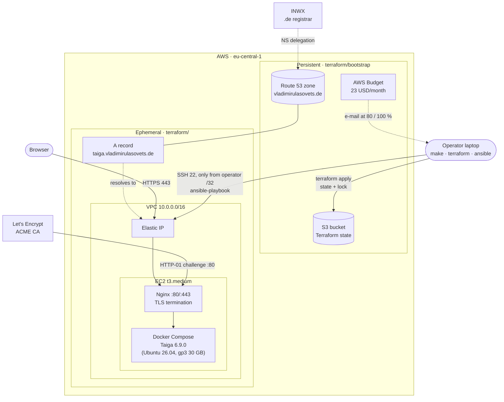
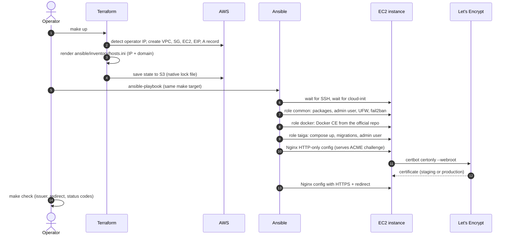

# Taiga on AWS with Terraform and Ansible

Self-hosted [Taiga](https://www.taiga.io/) (an open-source Kanban and Scrum tool), deployed on AWS with one command and destroyed with another.

```
make up      # empty AWS account -> https://taiga.vladimirulasovets.de with a Let's Encrypt certificate
make down    # everything temporary is gone; DNS zone, state bucket and budget stay
```

A pet project to practice cloud infrastructure and Infrastructure as Code. The whole stack is **rebuilt from scratch every working session** and destroyed at the end. That keeps the cost low and proves every session that the deploy is reproducible.

## Contents

- [Architecture](#architecture)
- [How `make up` works](#how-make-up-works)
- [Two Terraform stacks](#two-terraform-stacks)
- [What runs on the server](#what-runs-on-the-server)
- [Security](#security)
- [Repository structure](#repository-structure)
- [Getting started](#getting-started)
- [Daily usage](#daily-usage)
- [Design decisions](#design-decisions)
- [Cost](#cost)
- [Known issues and limitations](#known-issues-and-limitations)
- [Roadmap](#roadmap)

## Architecture



Traffic path: browser → DNS (Route 53) → Elastic IP → Nginx on the host (TLS) → Taiga containers bound to `127.0.0.1`. Only Nginx and SSH are reachable from outside.

## How `make up` works



No step needs manual input: the IP goes from Terraform to Ansible through the generated inventory, and the vault password comes from a local file.

## Two Terraform stacks

| Stack | Lifetime | State | Resources |
|---|---|---|---|
| [`terraform/bootstrap/`](terraform/bootstrap) | Persistent, applied once | Local (it creates the bucket, so it cannot live in it) | S3 state bucket, Route 53 hosted zone (imported), AWS Budget |
| [`terraform/`](terraform) | Ephemeral, `make up` / `make down` | S3, `use_lockfile = true` | VPC, subnet, IGW, route table, security group, key pair, EC2, EIP, `A` record, generated inventory |

**Why two stacks:** the main stack is destroyed every session. If the hosted zone were part of it, every rebuild would create a zone with new name servers, the delegation at the registrar would break, and DNS would need hours to recover. Long-lived resources are separated from ephemeral ones and protected with `prevent_destroy`.

The hosted zone was created by hand (AWS CLI) before the project used Terraform for DNS, and was brought under Terraform with an [`import` block](terraform/bootstrap/dns.tf) without recreating it.

## What runs on the server

Nginx runs on the host instead of the official `taiga-gateway` container, for full control over TLS and certificate renewal.

| Component | Image / package | Listens on | Role |
|---|---|---|---|
| Nginx | `nginx` (apt) | `0.0.0.0:80`, `0.0.0.0:443` | TLS, HTTP→HTTPS redirect, ACME challenge, reverse proxy |
| certbot | `certbot` (apt) | — | Certificate issue and renewal (systemd timer, reloads Nginx) |
| `taiga-front` | `taigaio/taiga-front:6.9.0` | `127.0.0.1:8001` | Web UI (Angular) |
| `taiga-back` | `taigaio/taiga-back:6.9.0` | `127.0.0.1:8000` | REST API (Django), `/api/`, `/admin/` |
| `taiga-async` | `taigaio/taiga-back:6.9.0` | — | Celery workers: e-mails, imports, exports, webhooks |
| `taiga-events` | `taigaio/taiga-events:6.9.0` | `127.0.0.1:8888` | WebSocket live updates, `/events` |
| `taiga-protected` | `taigaio/taiga-protected:6.9.0` | `127.0.0.1:8003` | Signed URLs for attachments |
| `taiga-db` | `postgres:14` | Docker network only | Database (named volume `taiga-db-data`) |
| `taiga-async-rabbitmq` | `rabbitmq:3.13` | Docker network only | Broker for Celery |
| `taiga-events-rabbitmq` | `rabbitmq:3.13` | Docker network only | Broker for live events |

Inside Docker, containers reach the database by its Compose service name `taiga-db`, not `localhost`.

**Files:** uploads (`/opt/taiga/media`) and Django static files (`/opt/taiga/static`) are bind-mounted from the host into `taiga-back` and `taiga-async`. Nginx serves static files directly. Media requests go to `taiga-protected`, which checks the signed token and answers with `X-Accel-Redirect: /_protected/<path>`; Nginx then serves the file from an `internal` location that clients cannot open directly.

## Security

| Layer | Measure |
|---|---|
| Network | Security group: 80 and 443 open, **22 only from the operator's current public IP (`/32`)**, detected by Terraform on every apply |
| Host firewall | UFW (deny incoming, allow 22/80/443), fail2ban for SSH |
| Containers | All Taiga ports bound to `127.0.0.1`, only Nginx is public |
| TLS | Let's Encrypt, TLS 1.2/1.3, HTTP redirects to HTTPS |
| Disk | EBS root volume encrypted |
| Secrets | Ansible Vault (`group_vars/taiga/vault.yml`, encrypted); vault password file outside the repo |
| Terraform state | S3: versioning, SSE-S3 encryption, all public access blocked, `prevent_destroy` |
| Admin password | Passed to Django through stdin, so it never shows up in the process list or Ansible output (`no_log`) |
| Git | `*.tfstate`, `*.tfvars`, `tfplan`, `hosts.ini` and vault password files are ignored |

## Repository structure

```
.
├── Makefile                      # up / down / check / timed-up
├── terraform/
│   ├── bootstrap/                # persistent stack: S3 state bucket, Route 53 zone (import), budget
│   ├── main.tf                   # providers, S3 backend with native locking
│   ├── network.tf                # VPC, subnet, IGW, route table, security group
│   ├── compute.tf                # key pair, EC2, Elastic IP, Ubuntu AMI lookup
│   ├── ssh_access.tf             # detects the operator IP for the SSH rule
│   ├── dns.tf                    # A record in the persistent zone
│   ├── inventory.tf              # renders ansible/inventory/hosts.ini
│   └── templates/hosts.ini.tftpl
├── ansible/
│   ├── ansible.cfg
│   ├── requirements.yml          # community.docker, community.general
│   ├── inventory/                # hosts.ini is generated, only the example is in git
│   ├── playbooks/
│   │   ├── site.yml              # wait for host -> common -> docker -> taiga
│   │   └── group_vars/taiga/     # vars.yml (plain), vault.yml (encrypted)
│   └── roles/
│       ├── common/               # packages, admin user, UFW, fail2ban, timezone
│       ├── docker/               # Docker CE from the official repository
│       └── taiga/                # compose stack, admin user, Nginx, certbot
└── docs/plans/                   # session plans
```

## Getting started

### Prerequisites

- AWS account and an AWS CLI profile with admin rights (`aws sts get-caller-identity` works)
- Terraform ≥ 1.16, Ansible (ansible-core ≥ 2.19), GNU Make (the macOS default 3.81 is fine)
- SSH key pair at `~/.ssh/id_ed25519` / `~/.ssh/id_ed25519.pub`
- A domain whose name servers point to a Route 53 hosted zone

### One-time setup

```bash
# 1. Persistent layer: state bucket, hosted zone import, budget
cd terraform/bootstrap
terraform init
terraform plan -out=tfplan    # expect: 1 to import, 0 to destroy
terraform apply tfplan

# 2. Ansible collections
cd ../..
make deps

# 3. Vault password, so make up runs without prompts
mkdir -p ~/.ansible
echo 'your-vault-password' > ~/.ansible/taiga-vault-pass
chmod 600 ~/.ansible/taiga-vault-pass
```

The vault (`ansible/playbooks/group_vars/taiga/vault.yml`) must define `vault_taiga_secret_key`, `vault_taiga_db_password` and `vault_taiga_admin_password`.

## Daily usage

| Command | What it does |
|---|---|
| `make up` | `terraform apply` + `ansible-playbook`, **staging** certificate |
| `make up STAGING=false` | Same with a **production** certificate (use for final runs only) |
| `make timed-up` | `make up` and prints the wall-clock duration |
| `make check` | Certificate issuer and expiry, HTTP redirect, HTTPS and API status codes |
| `make configure` | Only the Ansible part (re-run after a fix; the playbook can be re-run safely) |
| `make down` | `terraform destroy` of the ephemeral stack; bootstrap stays |

**Let's Encrypt rate limit:** the production CA issues at most 5 identical certificates per week. Since every session rebuilds the server, test runs use the staging CA (`STAGING=true` is the default). Browsers show a warning for staging certificates; that is expected.

After `make up`, log in at `https://taiga.vladimirulasovets.de` as `admin` with the password from the vault.

## Design decisions

| Decision | Alternatives | Why |
|---|---|---|
| Destroy and rebuild every session | Keep the server running | ~0.25 USD per session instead of ~45 USD/month; proves the deploy is reproducible |
| Separate persistent and ephemeral Terraform stacks | One stack | The DNS zone and state bucket must survive `make down` |
| Import the manually created zone | Recreate it with Terraform | Recreating means new name servers and broken delegation |
| S3 native locking (`use_lockfile`) | DynamoDB lock table | Supported since Terraform 1.10, one resource less, no extra cost |
| SSE-S3 encryption for state | KMS | Free, no key policy to manage, enough for this scale |
| SSH open only to the detected operator IP | `0.0.0.0/0`, bastion, SSM Session Manager | Simple and safe; a new network shows up as a reviewable plan diff. SSM is a possible next step |
| Inventory generated by Terraform (`local_file`) | Dynamic AWS inventory plugin | No extra plugin or AWS credentials for Ansible; the IP and domain come straight from state |
| `ansible_host` = IP, not FQDN | FQDN | A new DNS record may not have reached every resolver yet |
| Nginx on the host | `taiga-gateway` container, Traefik | Full control over TLS; certbot works with it natively |
| `certbot certonly --webroot` | `certbot --nginx` | `--nginx` edits the config, and the next Ansible run overwrites those edits and breaks HTTPS |
| Staging CA by default | Always production | Production allows 5 identical certificates per week |
| `StrictHostKeyChecking=accept-new` | `no`, or managing known_hosts | New host key on every rebuild; `accept-new` still rejects a *changed* key for a known host |
| Admin user via Django shell + stdin | `createsuperuser` with env var | The env var ends up in `docker exec --env` and the process list; `createsuperuser` exited non-zero even on success |
| Media and static on host bind mounts | Named Docker volumes, S3 storage backend | Host Nginx can read them (it cannot traverse `/var/lib/docker`); uploads survive container recreation; one directory to back up in step 2 |
| Docker CE from the official repo | Ubuntu `docker.io` | Current versions and the Compose v2 plugin |

## Cost

On-demand prices in `eu-central-1`, approximate:

| Item | Price | Per 4-hour session |
|---|---|---|
| EC2 `t3.medium` | ~0.048 USD/h | ~0.19 USD |
| EBS gp3 30 GB | ~0.095 USD/GB-month | ~0.02 USD |
| Public IPv4 (Elastic IP) | 0.005 USD/h | ~0.02 USD |
| Route 53 hosted zone | 0.50 USD/month | fixed |
| S3 state bucket | cents | fixed |
| Domain `.de` (INWX) | ~6 EUR/year | fixed |

The monthly AWS budget is 23 USD (~20 EUR) with e-mail alerts at 80 % and 100 %.

## Known issues and limitations

- **No backups:** `make down` deletes the database and all uploads. → Roadmap step 2.
- `taiga-events` writes JWT access tokens to its log (upstream default).
- A change to the Compose file restarts the Taiga containers twice (`state: present` already recreates them, then the `Restart taiga` handler restarts them again). Harmless, a few seconds of 502s.
- RabbitMQ reuses the database password instead of its own vault secret.
- The bootstrap stack keeps its state locally (can be migrated into the bucket with `terraform init -migrate-state`).
- Single instance, single availability zone, no monitoring.

## Roadmap

1. ~~One-command deploy with HTTPS on the real domain, S3 state, budget alert~~
2. Data persistence: `pg_dump` + media → S3 before `down`, restore after `up`, daily backup while the instance runs
3. CI: GitHub Actions with `terraform fmt/validate`, `tflint`, `ansible-lint`
4. Monitoring: Prometheus + Grafana + `node_exporter` + `postgres_exporter`
5. Migration from Docker Compose to k3s

Backlog: automated backup testing (integrity checks, restore into a throwaway container, restore drill with RTO measurement).
